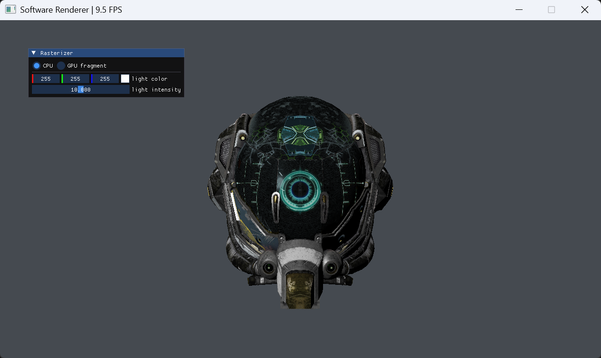
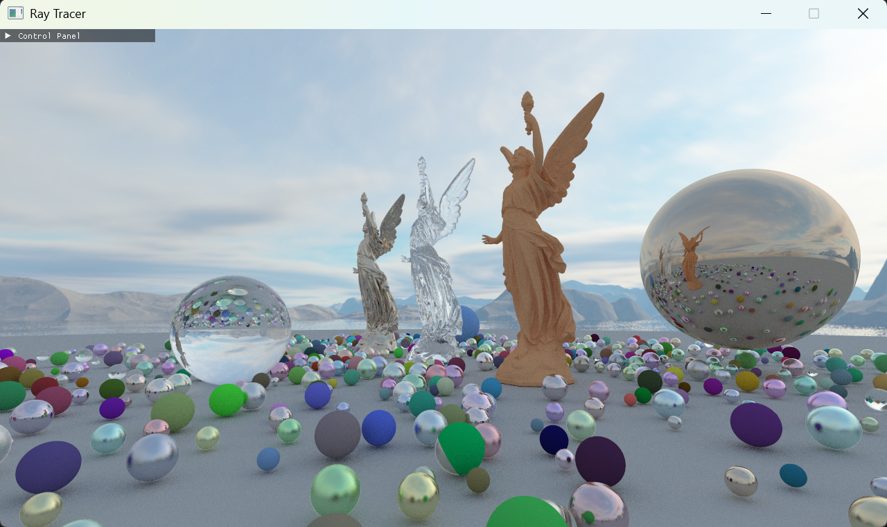

# AICG Projects

## Introduction

AICG Projects extends [CG-projects](https://github.com/syby119/CG-projects) with assignments in computer graphics and AI for Graphics. The curriculum includes two traditional rendering projects and four AI-focused projects. Students implement core techniques from first principles, then explore how learned models can expand graphics workflows.

The two traditional projects cover:

- Rasterization.
- Ray tracing.

The AI for Graphics projects cover:

- Preparing image and 3D data for learning-based graphics tasks.
- Training models to represent or generate visual content.
- Combining learned methods with rendering and image processing.
- Evaluating results through visual inspection and quantitative measures.

## Clone the repository

```sh
git clone https://github.com/syby119/AICG-projects-answer.git
cd AICG-projects-answer
```

## How to run

### Preliminaries

To build Projects 1 and 2, you need:

- Git and CMake 3.20 or newer.
- A C++20 compiler and standard library with `std::format` support.
- A graphics driver with OpenGL 4.1 support.
- [vcpkg](https://github.com/microsoft/vcpkg) to install the dependencies declared by each project's `vcpkg.json`.

### Build and run

Projects 1 and 2 have independent CMake projects and vcpkg manifests, so configure and build them separately. There is no repository-wide build. See the [Project 1 setup guide](projects/project1/README.md) and [Project 2 setup guide](projects/project2/README.md) for platform-specific instructions and runtime controls.

Guides for Projects 3–6 will be added as those assignments become available.

## Projects

| [Project 1: Software Renderer](projects/project1/) | [Project 2: Ray Tracing](projects/project2/) |
| --- | --- |
|  |  |
| Implement and compare CPU and GPU rasterizers, including clipping, triangle coverage, depth testing, and perspective-correct interpolation. | Implement CPU and GPU ray tracers that share scene data and progressively accumulate full-image samples. |
| Project 3 | Project 4 |
| To be added | To be added |
| Project 5 | Project 6 |
| To be added | To be added |
