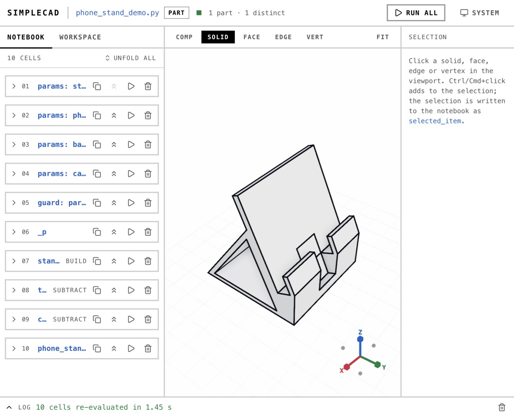

# Project 3: CAD Agent

English | [简体中文](README-zh.md)

Build an agent that turns a user's natural-language request into an editable 3D CAD model. The agent should clarify requirements, plan modeling steps, execute them through [SimpleCADAPI (SCA)](https://github.com/PhySpace/SimpleCADAPI), inspect the result, and revise it when checks fail. The final workflow must be runnable and reproducible.

The image illustrates a possible result. This directory currently contains the assignment guide, with no supplied implementation or build configuration.

## Required workflow

1. **Understand the request.** Accept a request through a command line or simple interface. Extract the intended structure, dimensions, units, and spatial relationships. Ask the user to resolve missing or contradictory key requirements before delivering a model.
2. **Plan and build.** Have a language model plan the steps, then call tools or generate a program that drives SCA. Create solid geometry, perform Boolean operations, and use at least one feature operation such as extrusion, filleting, or patterning. Keep key dimensions as editable parameters. Returning only code or loading a prefabricated model does not complete the task.
3. **Check and repair.** Check that the resulting solid is valid, and measure important dimensions and spatial relationships against explicit acceptance criteria. Feed execution errors and failed checks back to the agent, then rebuild or revise the model. Set a retry limit. A run without an exception is not sufficient evidence of correctness.
4. **Support changes in the same session.** Allow natural-language changes to dimensions or local features while preserving requirements the user has not changed. Show the model before and after the change. Save the parametric modeling source and export a STEP file. Keep the conversation, tool-call, and execution-feedback records.
5. **Test and analyze.** Test at least three structurally different modeling requests, including requirement clarification, multiple rounds of modification, and repair after an error. State acceptance criteria and dimensional tolerances. Record success or failure, dimension deviations, elapsed time, and repair attempts, then analyze failures.

For example, a request for a phone stand may require clarification of device size, portrait and landscape use, support angle, and charging clearance. Distinguish dimensions chosen by the user from values suggested by the agent, then demonstrate a later parameter change and its validation. The example is not a required model design.

## Tools and scope

- Use SCA for CAD modeling. An online API or local language model is acceptable; choose any suitable interface and model viewer. A custom 3D renderer is not required.
- Implement the tool wrappers, modeling workflow control, and result checks yourself. You may consult SCA documentation, Agent Skills, and open-source agent frameworks. If you use a framework, identify the modules you developed or improved and provide evidence that they work. Running an existing example or an existing CAD agent alone does not satisfy the assignment.
- Record software and model versions. Run generated code in a restricted environment with an execution timeout.
- A single agent that models one part from text is enough for the basic task. Training a language model, building a geometry kernel, and handling complex assemblies are not required. Possible extensions include image-and-text input, assemblies, and reuse of modeling experience. Model complexity is one factor in evaluation.

## Submission

Submit the agent code, prompts and tool definitions, test requests and acceptance results, parametric modeling source files and STEP models, execution logs, configuration and run instructions, and a demonstration video. A four-to-six-page report is recommended.

The video should show a request, automatic modeling, feedback-driven repair, and a later change in the same session. The report should explain the system design, test results, original contributions, and team responsibilities. Provide runnable setup and execution instructions for the implementation you submit; this guide does not prescribe a particular build command.
