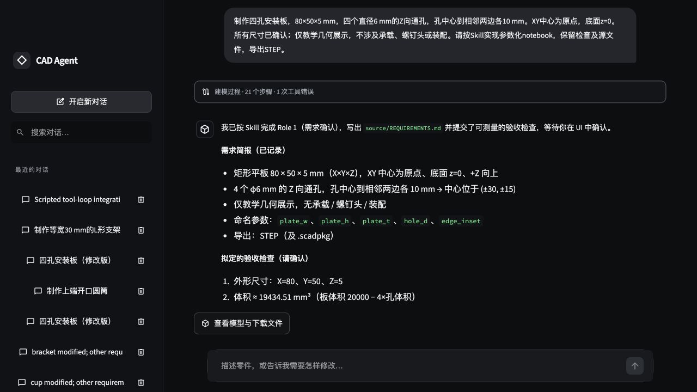
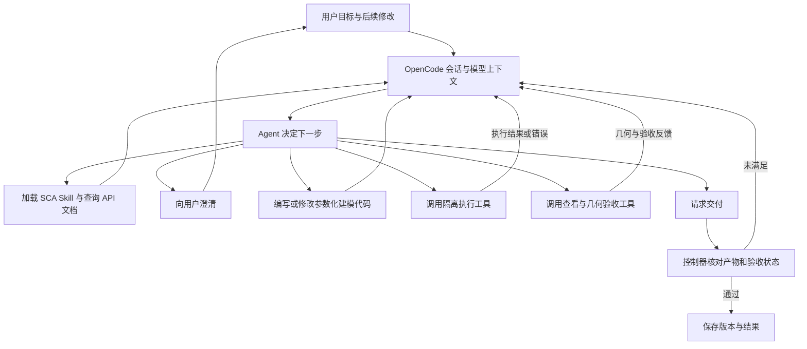
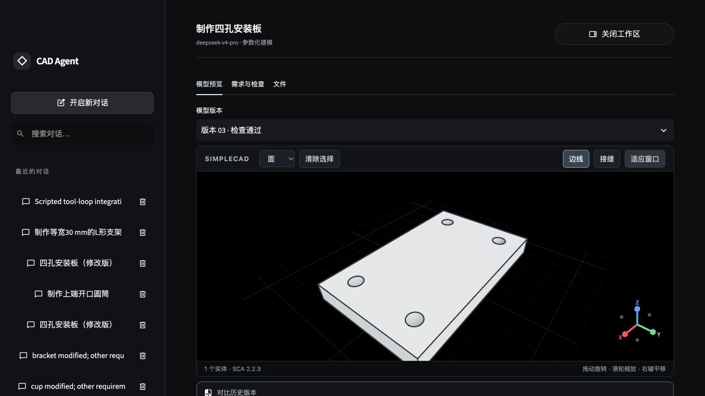

> **新版实现入口：** 当前 demo 已精简为 OpenCode 原生终端 + SCA 官方 Skill + `sca edit`，启动方式见 [SETUP_GUIDE.md](SETUP_GUIDE.md)。下文保留原课程设计说明，其中自建聊天页面、MCP 工具与独立验收服务描述的是旧版方案，不是新版运行依赖。

# Project 3：CAD 智能体

本作业面向计算机图形学与 AI for Graphics 课程，内容为基于大语言模型和 SimpleCADAPI（SCA）的交互式 CAD 建模。核心环节包括需求理解、建模规划、工具调用、几何检查和反馈修正。

本作业使用本地 OpenCode 作为 Agent harness，负责模型交互、会话上下文和工具调用循环。Agent 加载 SCA 官方 Skill，根据自然语言需求查阅接口、编写并执行参数化建模代码，观察模型和测量结果，再自主决定修正、提问或交付。最终结果包括可查看的三维模型、可编辑的参数化源文件和 STEP 文件。

基础示例采用四孔安装板，并通过开口圆筒和 L 形支架验证不同结构的建模过程。程序在本地运行，以简单聊天界面展示需求、工具执行和检查结果，使用现成模型查看器观察几何形状。

> 已提供可运行的最小实现。安装步骤见 [SETUP_GUIDE.md](SETUP_GUIDE.md)。OpenCode 2.0.20 **仅作为 harness 演示**，不是课程方案的必要依赖；可改用 Pi、Claude Agent SDK 等框架，迁移方式见第 10 节。

## 目录

- [1. 学习目标与先修知识](#1-学习目标与先修知识)
- [2. 环境配置与运行](#2-环境配置与运行)
- [3. 界面与操作](#3-界面与操作)
- [4. 项目结构](#4-项目结构)
- [5. 建模流程与数据约定](#5-建模流程与数据约定)
- [6. 作业任务](#6-作业任务)
- [7. 模型查看与导出](#7-模型查看与导出)
- [8. 调试与验证](#8-调试与验证)
- [9. 实验报告与提交建议](#9-实验报告与提交建议)
- [10. 可选扩展](#10-可选扩展)
- [11. 常见问题](#11-常见问题)
- [12. 资源与许可](#12-资源与许可)

## 1. 学习目标与先修知识

学习目标包括：

1. 将自然语言需求整理为结构、尺寸、单位和位置关系，区分已确认条件与待澄清条件。
2. 使用 Agent harness 和官方 Skill，使模型自主查阅资料、编写代码、执行工具并利用反馈继续建模。
3. 使用 SCA 构建参数化模型，理解参数、建模步骤与最终几何之间的关系。
4. 对生成实体进行有效性检查和几何测量，判断结果是否符合用户要求。
5. 将执行错误和测量偏差反馈给智能体，实现有终止条件的修正循环。
6. 在多轮对话中保留未修改的要求，对比修改前后的模型并导出可复现的结果。

先修知识包括三维坐标、刚体变换、基本实体、布尔运算和参数化建模。编程基础包括 Python 函数与类、JSON 数据、异常处理，以及大模型消息和工具调用的基本使用方式。

OpenCode 提供通用 Agent 执行循环，SCA 及其官方 Skill 提供几何能力和使用规范，现成查看器提供三维显示。本作业自行实现运行适配、执行与验收工具、需求和版本管理，以及任务预算和交付判定。不能仅启动现成 Agent 并运行示例作为作业成果。

## 2. 环境配置与运行

### 2.1 环境要求

| 组件 | 本实现使用方式 |
| --- | --- |
| Python / uv | Python 3.12，`pyproject.toml` 与 `uv.lock` 管理项目环境 |
| Node.js / npm | 下载固定版本的 OpenCode 本地二进制 |
| OpenCode | 2.0.20；只负责模型会话与自主工具循环 |
| Docker | Linux 容器；SCA 2.2.3 及依赖由 `sandbox/requirements.lock` 固定 |
| SCA 官方 Skill | 从同一镜像安装完整 Skill 和 API 参考到 `skills/simplecadapi/` |
| Streamlit / SCA Viewer | 深色聊天界面、工具记录和 SCA 原生场景预览 |
| 模型 API | OpenAI-compatible 工具调用接口；通过项目 `.env` 配置 |

本地验证环境为 macOS Apple Silicon、Python 3.12.15、OpenCode 2.0.20、SCA 2.2.3。其它系统的安装说明见指南，未声称已在所有平台测试。

### 2.2 安装与启动

先安装 Git、Node.js、uv 和 Docker 并启动 Docker 引擎。进入 `projects/project3/`，在 macOS/Linux 执行：

```bash
export UV_CACHE_DIR="$PWD/.cache/uv"
export UV_PYTHON_INSTALL_DIR="$PWD/.runtime/python"
uv python install 3.12
uv sync --frozen
uv run python scripts/manage.py install
cp .env.example .env
# 编辑 .env，填写 LLM_BASE_URL、LLM_MODEL、LLM_API_KEY
uv run python scripts/manage.py doctor
uv run python scripts/manage.py serve
```

打开 <http://127.0.0.1:8503>，终端按 Ctrl+C 停止。Windows PowerShell 命令、软件安装及故障排查见 [SETUP_GUIDE.md](SETUP_GUIDE.md)。`doctor` 检查本地依赖，不调用付费模型。

### 2.3 配置与本地数据

| 配置项 | 含义 |
| --- | --- |
| `LLM_BASE_URL` | 模型 API 地址，例如 `https://api.deepseek.com/v1` |
| `LLM_MODEL` | 模型 ID，例如 `deepseek-v4-pro` |
| `LLM_API_KEY` | 个人密钥，只写入被忽略的 `.env` |
| `OPENCODE_PORT` | 本地 harness 端口，默认 4098 |
| `CAD_IMAGE` | 建模镜像名，默认 `cad-agent-demo:sca2.2.3` |

启动脚本生成 `.runtime/config/opencode/opencode.json`，显式注册 Skill、MCP 工具与自定义 Agent；密钥通过环境变量传入。OpenCode 配置、数据、缓存及服务器口令保存在项目 `.runtime/`，不改全局 Agent 配置。Python 环境、下载缓存、Skill 和会话产物也在项目内。Docker 镜像及引擎内部数据仍由本机 Docker 管理。

### 2.4 Skill 接入

`manage.py install` 调用镜像内的 `sca skill install --target opencode --skills-dir /skills`，保留完整入口、工作流、建模规则与 API 参考。本版本共 428 个 Markdown 文件。`AGENTS.md` 要求先调用原生 `skill` 工具，再按需调用 `cad_read_document` 阅读参考。

Skill 是官方原文，不以自编提示词替代。宿主绑定规则说明了本 demo 的工具名称、结构化提问入口及单 Agent 范围：代码通过离线容器执行，视觉检查由人在查看器完成，不宣称复现官方 Skill 中所有多 Agent 或视觉审查机制。

修改提示词、工具定义或模型配置后重启程序并新建会话。升级 SCA 时同步更新镜像、锁文件和 Skill，并重新验证。

## 3. 界面与操作

界面采用常见的大模型聊天网页布局：左侧按对话标题显示历史记录并支持搜索，中间为聊天区与底部固定输入框，右上角可打开占满聊天主区域的模型工作区，查看后点击“关闭工作区”回到对话。空白对话提供三个示例入口，点击只填入草稿，由用户发送。工具调用合并为可展开的建模过程，保留原始记录。每个会话同一时间只执行一轮建模。



| 操作或显示 | 作用 |
| --- | --- |
| 新建会话 | 清空当前需求上下文，开始独立建模任务 |
| 删除对话 | 点击对话右侧垃圾桶；支持立即撤销，或从“已删除的对话”中恢复 |
| 输入建模需求 | 描述结构、尺寸、单位及位置关系 |
| 回答澄清问题 | 补充关键条件，确认后继续执行 |
| 参数摘要 | 查看用户已确认的要求和待确认的建议 |
| 工具记录 | 查看 Skill 加载、文档读取、代码修改、执行和测量记录 |
| 检查结果 | 查看目标值、实测值、偏差及是否通过 |
| 版本选择 | 选择修改前后的模型，在查看器中比较 |
| 下载结果 | 保存参数化源文件和 STEP 文件 |

基础示例从“做一块四角带孔的安装板”开始。智能体应先询问长宽厚、孔径及孔中心到边的距离，再执行建模。首次检查通过后，输入“厚度改成 8 mm，其他不变”，检查新模型的厚度，并确认板长、板宽和孔位未改变。

全宽工作区包含“模型预览”“需求与检查”“文件”三个页签；查看器支持旋转、缩放及两个版本的上下对比。信息不足时在聊天中显示问题卡片，信息足够则直接建模。课堂演示应同时展示模型和检查记录，避免只展示最终形状而省略需求澄清与执行反馈。

## 4. 项目结构

实现采用以下目录划分，所有新增配置均位于本项目中：

```text
projects/project3/
├── README_DEMO.md               项目说明
├── SETUP_GUIDE.md               软件安装、配置、自检与启动指南
├── pyproject.toml / uv.lock     Python 依赖与锁文件
├── .env.example / .gitignore    配置示例与本地文件忽略规则
├── AGENTS.md                    Skill 加载、建模与交付规则
├── skills/
│   ├── README.md                官方 Skill 来源、版本和安装方式
│   └── simplecadapi/            从锁定版本生成的完整官方 Skill
│       ├── SKILL.md             Skill 入口
│       └── ...                 官方包提供的工作流与参考资源
├── scripts/                    本地安装、自检、启动与停止入口
├── sandbox/Dockerfile          最小 SCA 建模执行环境
├── app/
│   ├── ui.py                   简单聊天与结果展示
│   ├── harness.py              OpenCode 会话、事件与提问适配
│   ├── session.py              需求、版本和运行记录
│   └── controller.py           任务预算、检查反馈与交付状态
├── tools/
│   ├── server.py               向 harness 注册教学工具
│   ├── execute.py              隔离执行模型生成的建模代码
│   ├── inspect.py              读取产物并进行几何测量与验收
│   └── artifacts.py            模型查看、版本保存和导出检查
├── examples/cases.json         测试需求与验收标准
├── tests/                      Skill 接入、工具与闭环测试
├── .streamlit/config.toml      项目内深色主题
├── .runtime/                   OpenCode 配置、SCA 查看器资源、数据及缓存
└── workspace/                  会话代码、模型与执行日志
```

`skills/simplecadapi/` 的内部结构由官方安装结果确定；上图不定义或改写其内部 API 文档。目录可以由安装步骤生成，不要求将第三方 Skill 全量提交，但来源和版本必须可追溯，缺失时应明确报错。

| 模块 | 职责 |
| --- | --- |
| OpenCode | 模型请求、上下文管理、工具调用循环和用户提问 |
| `AGENTS.md` | 要求加载 Skill、确认关键需求、执行检查后才能交付 |
| 官方 SCA Skill | 指导 Agent 选择建模方式、阅读接口和执行检查 |
| `app/harness.py` | 适配固定版本的 OpenCode；不复制其内部 Agent 循环 |
| `app/controller.py` | 限制总调用预算和修复次数，传递验收反馈，判定交付状态 |
| `tools/execute.py` | 执行 Agent 生成的 SCA 程序，返回输出、错误和产物信息 |
| `tools/inspect.py` | 按已确认需求对实际几何进行独立测量 |
| `app/session.py` | 保存需求、代码和模型版本，关联修改前后结果 |

原有课程说明及图片保留。失败的尝试不得覆盖已有成功版本。依赖安装目录、生成的 Skill、本地配置与运行文件的提交规则写在本项目 `.gitignore` 中。

## 5. 建模流程与数据约定

### 5.1 Harness、Skill 与 Agent 循环



图中的工具分支由 Agent 根据上下文选择，不是固定执行顺序。Agent 可以多次读取文档、修改代码、执行和检查，也可以因条件不足暂停提问。程序只施加预算、执行边界和验收条件，不替模型预先写好每种零件的建模步骤。

第一次编写、修改或运行 CAD 代码前，Agent 必须加载官方 SCA Skill，再按照其中规定的加载顺序阅读对应工作流和所用 API 页面。Skill 提供指导，OpenCode 承载推理与工具交互；仅把 Skill 文本拼入一次提示词并调用模型一次，不构成本项目的实现。

对于修复场景，执行或验收结果必须进入下一次模型请求，随后由 Agent 决定如何修改。外层控制器可以要求再次检查或拒绝交付，但不能用硬编码几何修补冒充 Agent 修复。

### 5.2 坐标、单位与参数

| 项目 | 约定 |
| --- | --- |
| 长度单位 | 统一为 mm；其他输入单位先换算并在摘要中确认 |
| 世界坐标 | 采用右手坐标系，Z 轴向上，XY 平面作为默认基准平面 |
| 位置关系 | 明确使用中心坐标、边距或基准面距离，避免混用 |
| 用户要求 | 保存已确认值；缺失或互相冲突的关键条件需要澄清 |
| 模型建议 | 与已确认要求分开记录，确认后才能用于交付 |
| 修改操作 | 只更新本轮明确修改的条件，其余要求继续生效 |

例如“孔距边缘 10 mm”应明确为孔中心到边的距离，或孔边到板边的距离。两种定义会产生不同孔位，不能由程序无提示地混用。

### 5.3 关键中间数据

| 数据 | 内容 | 用途 |
| --- | --- | --- |
| 需求状态 | 结构、参数、单位、位置约束及确认状态 | 澄清和多轮修改 |
| 参数化程序 | 参数、SCA 操作、源文件版本 | 自主建模、修改和重建 |
| 工具结果 | 成功状态、实体引用、错误信息及耗时 | 反馈和执行追踪 |
| 检查记录 | 目标值、实测值、容差、偏差及通过状态 | 判定是否满足需求 |
| 模型版本 | 参数、源文件、模型文件和检查记录 | 修改前后比较和复现 |

检查记录必须来自实际几何，不能将输入参数原样返回作为测量值。包围盒可以验证外形尺寸，但不能单独证明孔径、壁厚或内部结构正确。

## 6. 作业任务

### 6.1 任务范围

基础任务限定为单用户、本地运行、文本驱动的单零件建模，使用一个 OpenCode Agent。简化界面、部署和服务组织，不把建模能力限制为少数模板或预设形状。

Agent 按官方 Skill 和实际 SCA 能力自主组合建模操作。圆角、倒角、阵列等操作不因“最小 demo”而人为列为未开放能力；具体操作是否可用，以锁定版本的 SCA 文档和实际执行结果为准。遇到不支持的需求应说明限制并澄清。

### 6.2 第一部分：Harness 与 Skill 接入（必做）

| 任务 | 实现位置 | 要求 |
| --- | --- | --- |
| Agent-1. Harness 接入 | `app/harness.py` | 创建和恢复会话，提交消息，接收工具与执行事件，处理用户提问 |
| Agent-2. Skill 接入 | `scripts/`、`skills/`、`.runtime/` | 安装匹配 SCA 版本的官方 Skill，注册发现路径并验证实际加载 |
| Agent-3. 需求与规则 | `AGENTS.md`、`app/session.py` | 记录确认条件，要求缺失或冲突条件先澄清，保留多轮上下文 |
| Agent-4. 执行工具 | `tools/execute.py` | 执行自主生成的 SCA 代码，提供隔离、超时和结构化反馈 |

### 6.3 第二部分：检查、修复与交互修改（必做）

| 任务 | 实现位置 | 要求 |
| --- | --- | --- |
| Agent-5. 几何验收 | `tools/inspect.py` | 对产物进行实体、尺寸和位置检查，不以模型文字作为结论 |
| Agent-6. 闭环控制 | `app/controller.py` | 将失败反馈交回 Agent，限制预算并核对交付条件 |
| Agent-7. 多轮修改 | `app/session.py`、`app/harness.py` | 复用同一会话，保留未修改需求，记录代码及模型版本 |
| Agent-8. 结果交付 | `tools/artifacts.py`、`app/ui.py` | 展示修改前后结果，保存源文件、STEP 和完整过程记录 |

报告应明确哪些能力来自 OpenCode 和 SCA，哪些由本项目开发。运行适配、教学工具、验收控制和测试应有对应代码及证据，不能仅提交现成框架的启动配置。

### 6.4 实现说明：自主规划与工具反馈

OpenCode 管理模型与工具交互，Agent 决定何时查资料、写代码、运行、测量或提问。Python 应用负责桥接事件和用户交互，不再另建一条平行的模型调用链。

教学工具返回操作状态、文件引用、标准输出、错误及测量结果。失败结果进入同一 Agent 会话；观察日志应能追踪“执行失败 → 模型读取反馈 → 修改代码 → 再次执行 → 重新验收”。

任务控制器限制总时长、工具调用预算及自动修复次数。Harness 报告执行结束与作业验收通过是两个状态，界面应分别处理。

### 6.5 实现说明：参数化程序与执行边界

Agent 根据 Skill 自主编写 SCA Python 程序，关键尺寸使用命名参数。用户提出修改时，Agent 可以修改程序并重新执行，而不是只向一个预设函数填参数。交付的源文件应保留重建所需内容。

生成代码通过本项目执行工具进入本机 Docker 建模环境。环境采用非 root 用户、只读基础文件系统、受限临时空间、执行超时及 CPU/内存限制；仅挂载当前运行的源文件快照，关闭建模进程网络，不挂载宿主机密钥、其他项目或 Docker 套接字。执行 SDK 与 Skill 版本一致。

OpenCode 留在本地连接模型服务，建模代码在隔离环境执行。配置默认拒绝工具，仅允许 `simplecadapi` Skill 和 `cad_*` 工具；实测模型请求中未暴露通用宿主 Shell/编辑工具。文件工具限制路径，容器参数由宿主固定，不接受模型提供任意 Docker 参数。

这是单机 demo 的执行边界，不包含云端调度、账户或多租户服务。普通子进程、工作目录和超时本身都不能替代隔离机制。

### 6.6 实现说明：检查与终止条件

一次成功交付要求：执行完成、实体有效、声明的尺寸和位置检查通过，以及文件导出成功。当前独立验收支持包围盒、体积、轴对齐平面坐标和 Z 轴圆柱面的半径、位置及跨度；它只证明声明的可测条件，不能证明任意结构完整正确或适合制造。验收工具读取实际产物和已确认条件，不能依赖生成程序自行输出“通过”。

Agent 可根据反馈继续查阅 Skill、调整代码并重试；自动修复最多进行 2 次，即首次执行后最多增加两次修正尝试。每次反馈包含失败阶段、目标值与实测值，或具体执行错误。达到上限后报告失败，保留已有成功版本及失败记录。

用户需求冲突应返回澄清流程。不得通过擅自改变已确认的要求或放宽容差来使检查通过。

## 7. 模型查看与导出

### 7.1 模型显示

使用 SCA 2.2.3 安装包自带的渲染器读取 `.scadpkg` 场景观察实体外形、孔和开口、相交关系及局部特征。查看前后版本时可手动调整观察方向，结合尺寸检查表确认变化范围。

删除采用可恢复标记：从正常会话列表隐藏，不清除模型文件和 OpenCode 历史；运行中的会话不能删除。

查看器直接复用固定 SCA 版本的渲染核心，提供面/边/顶点选择、实体边线、接缝、网格、坐标轴和适应窗口。它是只读预览，不启动 SCA notebook 编辑器或执行生成的代码。

三维显示用于辅助判断。仅凭截图不能确认孔径、底厚或其他内部尺寸，必须结合几何查询。

### 7.2 参数化源文件与 STEP

每个成功版本保存参数化 Python 源文件和 STEP 文件。源文件保留关键参数及重建步骤；STEP 用于交换几何结果，不作为参数化建模历史的替代品。

通过界面的“完整源码与验收记录 ZIP”下载辅助 Python 模块、需求/计划及验收记录。导出后检查文件非空且能够重新读取。源文件重建结果应与该版本的验收记录一致。

### 7.3 会话与执行记录

按版本保存用户需求、确认参数、工具调用、执行反馈和检查结果，记录软件及模型版本。源文件、STEP 和日志必须对应同一次建模结果。

日志不记录 API 密钥。提交时选择与实验有关的记录，并保留失败案例用于分析。

## 8. 调试与验证

### 8.1 按阶段调试

按“harness 启动 → Skill 发现与加载 → 模型连接 → 隔离执行 → 独立几何检查 → 反馈循环 → 多轮修改 → 导出重建”的顺序验证。先用明确参数检查执行和测量，再接入自然语言需求，避免将几何错误误判为模型理解错误。

对反馈修复，可以注入明确标记的工具错误或尺寸偏差，确认模型确实收到反馈并重新执行。故障注入和自然发生的模型错误应分别统计。

### 8.2 建议测试

至少完成以下三类结构不同的任务。关键线性尺寸的默认绝对误差上限为 0.1 mm；实体有效性、数量和孔数必须完全满足要求。其他指标单独定义验收条件。

| 测试 | 输入与操作 | 主要检查 |
| --- | --- | --- |
| Skill 发现与加载 | 新会话要求执行建模任务 | 日志中可见官方 Skill 加载，以及按需读取工作流与 API 文档 |
| 自主执行循环 | 给出需要建模与检查的目标 | 可见多步模型决策、代码编辑、工具反馈和后续模型调用，不是固定模板或单次生成 |
| 隔离与绕过检查 | 尝试访问会话外目录、宿主机执行、网络和超时执行 | 越界和绕过被实际拒绝，超时进程终止；正常建模仍可完成 |
| 四孔安装板 | 澄清为 80 × 50 × 5 mm，四个 Ø6 mm 通孔，孔中心距相邻边各 10 mm；随后厚度改为 8 mm | 外形尺寸、孔径、孔位和贯穿性；修改后长宽及孔位不变 |
| 开口圆筒 | 外径 40 mm、高 30 mm、壁厚 3 mm、底厚 4 mm，上端开口；随后壁厚改为 4 mm | 外径、高度、内径、底厚和开口；修改后外形尺寸不变 |
| L 形支架 | 等宽 30 mm，外侧水平长度 50 mm、外侧高度 40 mm、厚度 5 mm；随后高度改为 50 mm | 总体尺寸、壁厚、连接关系和单实体有效性；其余尺寸不变 |
| 参数缺失或冲突 | 不给单位，或指定互相矛盾的尺寸 | 先澄清，不能直接交付 |
| 工具执行错误 | 注入一次工具失败并返回具体错误 | 读取错误、修改操作并重新检查 |
| 重试上限与超时 | 连续失败或执行超过时限 | 有限终止，显示原因，保留已有结果 |
| 导出与重建 | 重新读取 STEP，运行保存的源文件 | 文件可用，重建几何满足同一验收条件 |

每次测试记录输入、预期结果、实测结果和差异。未执行的用例标记为未运行；不以单次成功推断任意需求均可处理。

### 8.3 性能记录

保持模型、提示词、Skill、工具定义及测试需求一致，记录系统、CPU、Python、OpenCode、SCA 及 Skill 版本、总耗时、模型调用次数、工具执行时间和修复次数。

区分模型服务等待时间与本地几何计算时间。网络和模型采样会影响重复运行结果，应同时记录成功情况和失败原因，再比较耗时。

### 8.4 本次验证记录

可复核的测试结果见 [TEST_RESULTS.md](TEST_RESULTS.md)。区分三类证据：固定 SCA 程序验证几何工具；脚本化模型接口验证 OpenCode 工具回环；真实 DeepSeek V4 Pro 验证自主建模。后两者不混为同一成功率，测试中的需求确认由固定测试规格模拟用户完成。

运行命令：

```bash
uv run pytest -q
uv run python scripts/verify_geometry.py
uv run python scripts/verify_sandbox.py
# 先启动 manage.py serve；下面命令会调用模型
uv run python scripts/verify_live.py plate
```

下图为真实模型生成的安装板厚度修改版（8 mm），不是示意图：



## 9. 实验报告与提交建议

报告建议包含：

1. **环境：** 操作系统、Python、SCA、模型服务及具体模型版本。
2. **完成情况：** Agent-1 至 Agent-8 的实现状态、对应文件及已知问题。
3. **方法：** harness 分工、Skill 加载机制、自主工具循环、执行隔离、几何验收和终止条件。
4. **结果：** 三类模型及修改前后截图，关键尺寸的目标值、实测值和偏差。
5. **分析：** 成功情况、耗时、修复次数，至少一个失败或修复案例及原因。
6. **自主工作与引用：** 自行实现的模块、成员分工，以及外部模型、库、资料和工具辅助的使用范围。

可围绕以下问题分析：

- 为什么几何程序执行成功不能直接代表建模任务完成？
- 如何区分缺失条件、用户需求冲突和工具执行错误？
- 为什么输入参数不能替代实际测量？
- 多轮修改时，如何确认未指定的尺寸没有变化？
- STEP 文件与参数化源文件分别保留了什么信息？

提交代码、提示词与工具定义、依赖和配置示例、`SETUP_GUIDE.md`、测试结果、参数化源文件、STEP、运行日志及演示视频。视频应覆盖需求输入、澄清、自动建模、反馈修复和多轮修改。实验报告建议为 4 至 6 页。

在干净环境中验证安装与启动步骤，确保文档、代码和结果一致。虚拟环境、下载缓存和实际密钥不属于提交材料。

## 10. 可选扩展

### 10.1 更换 harness

**这里使用 OpenCode 仅作为演示，项目并不要求必须使用 OpenCode。** 可以采用 Pi、Claude Agent SDK 或其它支持多轮工具调用的 harness。`app/harness.py` 的 `Harness` 协议划分了 `create/ready/send/messages/interrupt/close`；实现对应适配器，并在 `app/controller.py` 替换构造入口即可开始迁移。

迁移还需适配消息/工具事件格式、会话恢复、模型凭证、Skill 发现与工具权限；不是修改一个配置值就可直接切换。保留现有 MCP 工具或包装为目标框架原生工具，继续沿用项目的需求确认、容器执行、独立几何验收及交付规则。验证时应重新检查实际 Skill 加载、失败后的继续调用及宿主执行权限。Pi 与 Claude 的适配器未在本 demo 实现或测试。

### 10.2 其它扩展


- **复杂特征建模与验证：** 使用 SCA 的特征操作完成更复杂零件，验证局部尺寸及操作后的实体有效性。
- **提高检查覆盖：** 验证更多局部尺寸、间距、壁厚和连通性。
- **改善交互：** 增加参数对比、版本差异显示或执行中止。
- **多模态输入：** 根据参考图片和文字提取结构，明确尺度与歧义的处理方式。
- **复用建模经验：** 检索已有操作序列，并根据新需求调整和重新验证。

每项扩展应说明新增能力、适用范围和验证方式。扩展不能替代基础任务中的实际建模与结果检查。

## 11. 常见问题

| 现象 | 检查方向 |
| --- | --- |
| SCA 或几何依赖导入失败 | 检查 Python 版本、系统架构、虚拟环境和系统运行库 |
| 模型接口认证失败 | 检查本项目 `.env` 的端点、模型名及密钥 |
| Agent 找不到 SCA Skill | 检查安装版本、发现路径、入口文件及引用资源，核对会话实际加载记录 |
| 模型只回答文字、不调用工具 | 检查 harness 模型配置、工具注册、权限及 Skill 是否加载 |
| 生成代码直接在宿主机运行 | 检查通用工具权限与执行工具路由，修复绕过后再运行 |
| Agent 不断询问相同参数 | 检查用户回答是否写入需求状态并进入后续上下文 |
| 模型外形尺寸正确但结构不符 | 增加孔、壁厚、开口及位置关系检查，不能只测包围盒 |
| 工具成功但界面显示旧模型 | 检查模型版本、输出路径及查看器刷新 |
| 修改一个尺寸后其他尺寸变化 | 检查参数合并规则和未修改要求的回归检查 |
| 智能体反复尝试无法结束 | 检查工具调用上限、修复次数和执行超时 |
| STEP 无法打开或源文件无法重建 | 检查导出结果、依赖版本、路径和参数完整性 |
| 结果无法复现 | 核对模型、提示词、工具、依赖版本及原始需求记录 |

排查时保留终端输出和对应会话记录，先定位失败阶段，再判断属于配置、模型调用、几何执行还是验收问题。

## 12. 资源与许可

课程原始要求见 [README-zh.md](README-zh.md) 和 [README.md](README.md)。SCA 2.2.3 的接口与操作规范以随包 Agent Skill 为准。OpenCode 的发现机制、工具权限和服务接口以固定版本的验证结果为准。安装官方 Skill 时保留其来源及许可说明，不将第三方内容标为自主开发。

仓库软件许可见 [LICENSE](../../LICENSE)。第三方依赖、模型服务和外部资源遵循各自许可或使用条款。示例几何应由本项目实际生成；引用外部代码、资料或图片时记录来源及使用范围，不将仓库软件许可视为所有外部资源的授权。

### 需求不明确时的交互

Agent 通过 OpenCode 的 `question` 工具提出结构化问题，界面提供选项和自定义回答。优先澄清用途、形状，再补齐必要尺寸；已经明确的内容不重复询问，建议尺寸需要用户确认。回答通过表单接口回传，同一轮 Agent 继续执行，等待回答不占用建模超时。需求完整后直接记录验收条件并开始建模，无需额外确认。其它 harness 可提供等价的提问、等待与恢复适配。

运行过程按时间顺序逐条展示 Agent 回复和工具调用：每个调用显示名称、对象、执行状态及返回摘要，每次调用默认收为一行，点击下拉展开参数、结果及错误详情；聊天区自动跟随新内容，并保留停止入口。
