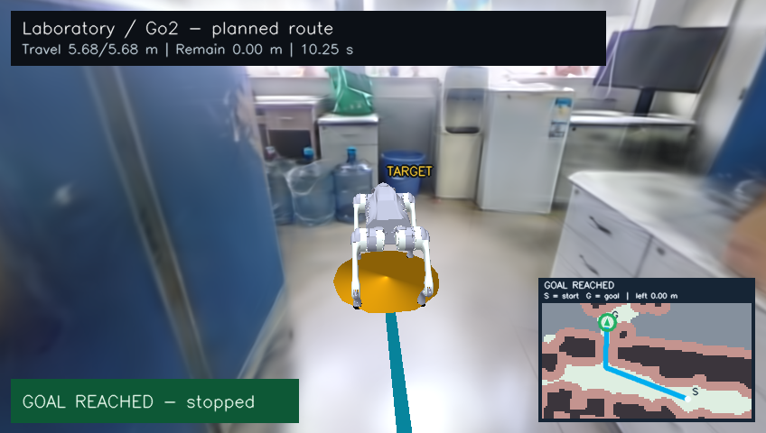

# 实验室 3DGS 场景中的 Go2 导航最小 Demo

本例从 `Trajectory_data_generate2NavDP` 裁剪而来，复现原来的
`outputs/test_smoke/robot_animation_lab/go2_real_scene.gif`：在真实重建的实验室里，
重新规划一条避障路线，让 Go2 沿路线移动，显示已走路径、剩余距离和到达状态。



[参考视频](examples/reference_lab.mp4) · [完整安装与运行指南](SETUP_GUIDE.md) · [数据和代码来源](NOTICE.md)

## 快速启动

在 `projects/project4/` 内执行，要求 Linux x86_64、Python 3.10、FFmpeg 和支持 CUDA 的 NVIDIA GPU：

```bash
./scripts/setup_env.sh gpu
./scripts/run_demo.sh check
./scripts/run_demo.sh preview
./scripts/run_demo.sh render
```

输出为 `outputs/animation/go2_real_scene.gif`、`go2_real_scene.mp4` 和
`animation_report.json`。运行过程实际加载场景、执行 A*、逐帧更新机器狗姿态并渲染，
参考视频仅供对照。

无 NVIDIA GPU 时可以验证路径规划和机器狗姿态：

```bash
./scripts/setup_env.sh cpu
./scripts/run_demo.sh plan
./scripts/run_demo.sh robot-preview
```

CPU 模式的 `robot-preview` 显示机器狗和导航标注，不渲染真实高斯背景。

## 输入与实现

- `assets/navigation/`：原始 LAS 构建的导航地图，以及从 LAS 提取的真实地面代表点。
- `assets/scene/`：实验室动画视野内的 829,269 个真实高斯，保留原始全部 float32 属性和 SH 系数，分块无损压缩。
- `assets/go2/`：Unitree Go2 URDF、实际外观网格及上游许可证。
- `configs/trajectories_lab.toml`：起终点、机器人半径、安全余量、规划参数。
- `configs/animation_lab.toml`：相机、帧率、时长、步态及渲染参数。
- `src/robotnav/navigation/trajectory/`：A*、路径简化、平滑和碰撞检查。
- `scripts/render_go2_scene_animation.py`：场景渲染、Go2 运动学步态、深度合成和视频导出。

默认路线长约 **5.681 m**，视频 **12 秒、240 帧、848×480**。机器狗使用解析逆运动学模拟步态，
基座位置按路线弧长插值；未进行物理动力学仿真或强化学习。报告里的到达误差是动画基座
与规划终点的距离，不是实机导航性能。

本机已使用项目内全新 `.venv` 完成 GPU 检查和完整渲染，渲染阶段约 38 秒。
五个抽查帧与原场景动画逐像素一致；记录见
[运行验证](examples/demo_validation.json) 和 [画面对照](examples/crop_validation.json)。

## 与课程完整要求的关系

这是现有实验室动画的最小可运行复现，包含单组起终点、场景已有障碍物和一条规划路线。
完整作业还要求同一任务不少于 3 条明显不同的无碰撞候选路线、指标比较与选择依据、
至少 3 组配置测试、可配置新增障碍，以及数据采集/重建说明和实验报告。
这些材料仍需按课程要求补充，当前例子不宣称已完成全部验收项。

特别注意：将 `trajectory_batch.count` 改为 `3` 生成的是一个批次的 3 个起终点任务，
不等同于为同一起终点生成 3 条候选路线。
