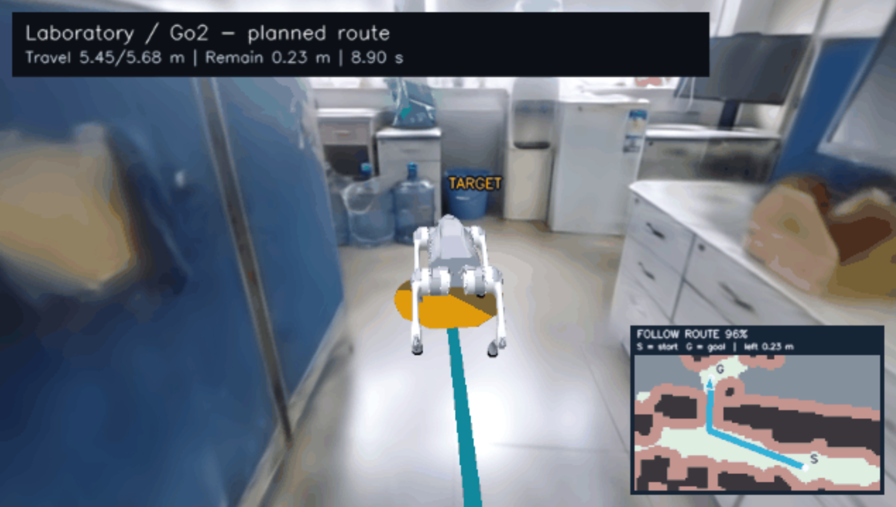

# Project 4: 3DGS Navigation

English | [简体中文](README-zh.md)

Capture and reconstruct a real environment with 3D Gaussian Splatting (3D-GS). Load the reconstruction into your own simulation or visualization program, add a robot dog, a goal, and obstacles, then plan and execute a collision-free route to the goal. The simulation must be runnable and reproducible.

The image illustrates the assignment. This directory currently contains the assignment guide, with no supplied implementation or build configuration.

## Required workflow

1. **Capture and reconstruct a scene.** Collect data from a real environment yourself, investigate a public 3D-GS method, reconstruct the scene, and load it into your simulation or visualization program. You may use course equipment or another suitable capture device. A public dataset, simulated data, or a ready-made scene supplied by someone else cannot replace your own captured scene.
2. **Configure the simulation.** Write scripts to place the robot model, start, goal, and obstacles. Make the configuration editable through parameters or interaction. Include at least one case where an obstacle blocks the straight line from start to goal. Keep map, robot, and reconstructed-scene coordinates consistent.
3. **Plan and compare routes.** For a feasible test setting, automatically generate at least three visibly different collision-free candidate routes. Show them, compare length and safety clearance, and explain why one is selected. Account for the robot's size when checking collisions.
4. **Execute the selected route.** Write logic that continuously updates the robot's position and orientation as it follows the selected route around obstacles. Define an arrival condition that accounts for the robot's size, and show the robot reaching the goal. Drawing a route or playing a prerecorded animation alone does not satisfy this requirement.
5. **Test and analyze.** Test at least three configurations with different starts, goals, or obstacle layouts. Replan after each change. Record planning time, route length, arrival error, and collision outcomes; analyze the main problems and possible improvements.

## Tools and scope

- Public reconstruction code, rendering tools, and existing robot models are allowed. The basic task requires your own core route-planning and trajectory-execution logic.
- A planar motion model, known robot pose, manually marked traversable areas, and simplified collision geometry for major scene obstacles and added obstacles are acceptable. Leg gait control and full SLAM are not required.
- Advanced directions include automatic map creation, fuller mapping and navigation, and dynamic obstacle avoidance. Existing navigation frameworks may be used for advanced work, but identify and validate the modules you developed or improved. Running an existing demonstration alone does not satisfy the assignment.

## Submission

Submit a description of the captured data, the reconstruction, your scripts and code, configuration and run instructions, and a navigation demonstration video. A four-to-six-page report is recommended.

The video should show scene configuration, multiple candidate routes, and the robot executing the selected route. The report should explain the algorithm choice, tests and results, original contributions, and team responsibilities. Provide reproducible setup and execution instructions for the implementation you submit; this guide does not prescribe a particular build command.
